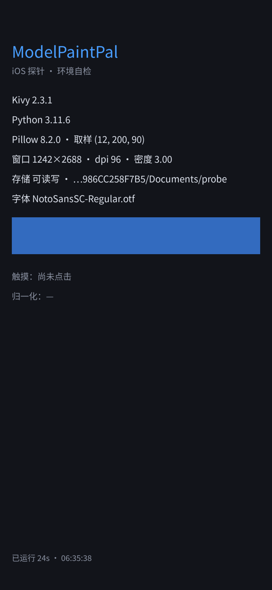

# ModelPaintPal · iOS

模型漆调色助手的 iOS 端，目标是在 App Store 上架。

桌面版（[ModelPaintPal](https://github.com/regdiliKUN/ModelPaintPal)）和安卓版
（[ModelPaintPal-APK](https://github.com/regdiliKUN/ModelPaintPal-APK)）已经在跑，
这个仓库只做 iPhone / iPad 这一份。

## 现在处于什么阶段

**探针已完成，结论：通。** 下一步是移植业务代码。

上一段必须先验证的问题是这个：

> kivy-ios 能不能在 Xcode 26 / iOS 26 SDK 下编出可安装、可启动的 Kivy 应用？

之所以不敢默认它能通：2026-04-28 起 App Store 只收 Xcode 26 + iOS 26 SDK 构建的包，
而 Kivy 稳定版仍是 2.3.1（2024 年 12 月），kivy-ios 正在往 Kivy 3 / SDL3 迁移，
官方里程碑排在 2027 年初。**没有现成案例能证明这条链当时通不通。**

现在有答案了，2026-10-27 在 `macos-26` + Xcode 26.4 上实测：



| 项 | 实测结果 |
|---|---|
| 工具链编译 | `python3 3.11.6`、`kivy 2.3.1`、`pillow 8.2.0`、`sdl2` 全家、`pyobjus` 全部 Build OK，双架构（真机 arm64 + 模拟器 arm64），冷缓存约 20 分钟 |
| 模拟器运行 | 装进 iPhone 11 Pro Max（iOS 26.5）正常启动，进程存活 |
| 真机包 | `-destination generic/platform=iOS` 未签名构建 **BUILD SUCCEEDED** |
| 窗口 | 1242×2688，dpi 96，密度 3.00（密度正确，`dp()/sp()` 换算没问题） |
| Pillow | 真实取样成功，`getpixel` 返回 `(12, 200, 90)`，与写入值一致 |
| 中文 | 自带 NotoSansSC 正常渲染，无方框 |
| 沙盒写入 | `<sandbox>/Documents/probe` 可读写 |
| 事件循环 | 计时器每秒跳动，24 秒后截图仍在跑 |

两个遗留项，不影响推进：

- **触摸没实测**——`simctl` 没有点击能力，坐标要等真机或 XCUITest 才能验。
  移植时沿用 Android 端已验证的「取色层铺满窗口」方案，把推导环节直接去掉。
- **Pillow 8.2.0 偏旧**（当前主线上是 11.x）。取色只用到 open/resize/getpixel，
  够用；真遇到性能问题再换 recipe 版本。

结论：**复用现有 Python 代码这条路成立**，不需要改写成 SwiftUI。

## 探针在验什么

`probe/main.py` 是一个没有业务代码的纯自检界面，屏幕上直接打印答案：

| 检查项 | 为什么是它 |
|---|---|
| Kivy / Python 版本 | 工具链真的把解释器和框架编进去了 |
| Pillow 版本 + 实际取样 | 取色功能的命根子，必须真打开图片取值，不能只 import |
| 窗口尺寸 / dpi / 密度 | 后面所有布局都靠这三个数换算 |
| 存储可读写 + 路径 | iOS 沙盒里能落到哪个可写目录 |
| 中文字体 | 自带 NotoSansSC，不指望系统字体回退 |
| 触摸 pos 与 sx·sy | Android 端「点左边、取右边」栽过三次，iOS 必须先验坐标系 |
| 计时器每秒跳动 | 事件循环真的在跑，不是开机卡一帧 |

模拟器截图会随 artifact 一起上传，那张图就是结论。

## 怎么跑

工作流是 `.github/workflows/probe.yml`，在 `macos-26` 机器上跑（自带 Xcode 26，
公共仓库不消耗额度）。手动触发或推 `probe/` 下的改动都会跑一次：

```bash
gh workflow run probe.yml
gh run watch
```

跑完去 artifact `probe-run-<编号>` 里拿 `sim-01.png`。

## 目录

```
probe/                  探针应用（会被 toolchain create 打包）
  main.py               自检界面
  assets/fonts/         思源黑体，中文显示用
.github/workflows/      探针 CI
.github/scripts/        模拟器取证脚本
```

移植开始后这里会长出 `mobile/`（共享界面层）、`app/`（从桌面仓库同步的核心层）、
`ios/`（平台适配层），结构和安卓仓库保持一致。

## 已知的硬门槛（不是代码问题）

1. **Apple Developer Program**：个人 ¥688/年，实名 + 双币信用卡。没有它无法上架，
   也无法用 TestFlight。
2. **中国区上架要 App 备案号**：只要应用有一次联网行为就必须有，否则国区上不了。
   本项目的「联网核实颜料信息」正好踩线，需要单独办备案（域名 + 大陆服务器 +
   管局审核 7~20 个工作日）。
3. **没有 Mac 也能做**，但所有构建只能在云端 macOS 上跑，一轮迭代按分钟计。

## 许可

与桌面版一致，见 [LICENSE](https://github.com/regdiliKUN/ModelPaintPal/blob/main/LICENSE)。
